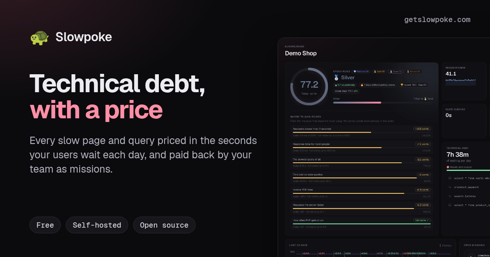
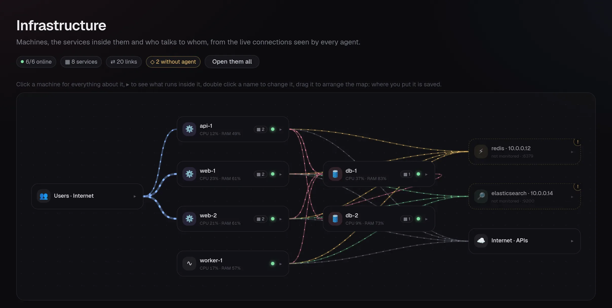
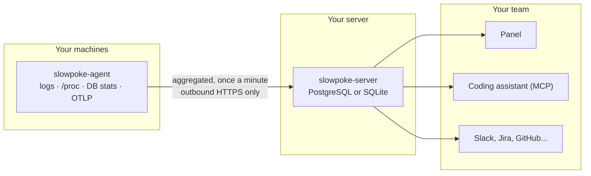

<p align="center">
  <a href="https://getslowpoke.com"></a>
</p>

<h1 align="center">🐢 Slowpoke</h1>

<p align="center">
  <b>Find out what your slow code costs, in seconds your users wait every day.<br>
  Then turn paying it back into a game your team wants to win.</b>
</p>

<p align="center">
  <a href="https://getslowpoke.com"><b>Website</b></a> ·
  <a href="https://demo.getslowpoke.com/demo"><b>Live demo</b></a> ·
  <a href="docs/quickstart.md"><b>Quick start</b></a> ·
  <a href="docs/README.md"><b>Docs</b></a> ·
  <a href="https://getslowpoke.com/vs/"><b>Compared with 15 other tools</b></a>
</p>

<p align="center">
  <a href="https://github.com/getslowpoke/slowpoke/actions/workflows/ci.yml"></a>
  <a href="LICENSE"></a>
  <a href="LICENSE-MIT"></a>
  
  <a href="#-it-never-slows-down-what-it-watches"></a>
</p>

---

## 🤔 Why

You just took over an app someone else built. Everyone says it is "a bit slow". Nobody can tell you
**how much** that costs, **where** it comes from or **what to fix first**, so it never gets fixed and
every month it gets a little worse.

Slowpoke answers those three questions with one number: **seconds of waiting per day**. A 40 ms query
that runs 90,000 times a day costs your users **an hour every day**. That is more than the 30-second
report everyone complains about, and now you can prove it.

```
TECHNICAL DEBT                                          ▼ 6% vs yesterday
2h 50m of waiting per day                        ✂ 20m 40s repaid per day

  ⛁  select count(*) from invoices where customer_id = ?   1h 5m/day   N+1
     app/Models/Order.php:88 · 31 times per request
  ⇄  GET /account/orders                                  26m 28s/day
  ∿  invoices.pdf                                         24m 58s/day

SPEED INDEX  59.7  🥉 Bronze          🔥 3 days without getting worse
🏆 WINS          10m 16s of waiting saved per day, since yesterday
```

These are real numbers from a real installation (seventeen machines, four applications) with the
line of code behind every slow query.

> 👀 **Just want to look?** Open the [live demo](https://demo.getslowpoke.com/demo). No sign-up: it
> logs you in and has 30 days of realistic data. It resets every night.

---

## 🚀 Get started in 3 commands

You need **Docker** on one server. That is all.

### 1. Start the panel

```sh
curl -fsSL https://getslowpoke.com/install.sh | sh
```

It starts Slowpoke and PostgreSQL, generates the database password on its own and asks you nothing.
Then open **http://your-server:8080** and create the first user (the first user is the admin) and
your first project.

### 2. Put an agent on each machine

In the panel go to **Machines → Add agent**, copy the line it gives you and run it on the machine:

```sh
curl -fsSL http://your-server:8080/install.sh | sudo sh -s -- --token spa_...
```

The agent looks at the machine and works out on its own what it can read (nginx sites, PHP-FPM pools,
MySQL or PostgreSQL, Redis, your apps and their framework). It writes its own configuration and
starts. Nothing on the machine is changed.

### 3. Wait fifteen minutes

Your first costs show up on the panel, along with a **map** of your machines and a list of what the
agent **cannot see yet**, each with the exact line that turns it on.

<p align="center">
  
</p>

That's it. No code changes, no YAML to write, no account anywhere.

---

## 🧰 Every command you will need

<details open>
<summary><b>The server</b></summary>

| What you want | Command |
|---|---|
| Install (or update: re-running is safe) | `curl -fsSL https://getslowpoke.com/install.sh \| sh` |
| Use another port | `... \| sh -s -- --port 9000` |
| Try it without a database container | `... \| sh -s -- --sqlite` |
| Install somewhere other than `/opt/slowpoke` | `... \| sh -s -- --dir /srv/slowpoke` |
| Check it is up | `curl -s http://localhost:8080/healthz` |
| Create a user from the terminal | `docker compose exec server slowpoke-server create-user -email you@example.com -name "Your Name" -password '...'` |
| Reset a forgotten password | `docker compose exec server slowpoke-server set-password -email you@example.com` |
| Load 30 days of demo data | `docker compose exec server slowpoke-server seed-demo -days 30 -name "Demo Shop"` |
| Back up the database | `docker compose exec postgres pg_dump -U slowpoke -Fc slowpoke > slowpoke-$(date +%F).dump` |

Run the `docker compose` commands from the install directory (`/opt/slowpoke` by default).
</details>

<details open>
<summary><b>The agent (one per machine)</b></summary>

| What you want | Command |
|---|---|
| Install | `curl -fsSL http://your-server:8080/install.sh \| sudo sh -s -- --token spa_...` |
| Give the machine a name | add `--name web-1` |
| Keep it on the same version as the server, by itself | add `--auto-update` |
| Remove it | `curl -fsSL http://your-server:8080/install.sh \| sudo sh -s -- --uninstall` |
| See what it would read on this machine | `slowpoke-agent detect` |
| Make nginx log how long each request takes | `sudo slowpoke-agent enable-duration --dry-run`, then without `--dry-run` |
| Undo that change | `sudo slowpoke-agent enable-duration --undo` |
| Print the version | `slowpoke-agent -version` |

`enable-duration` is the only command that changes a file on your server. It tests the configuration
with `nginx -t`, reloads, checks your sites still answer and puts everything back if they don't.
</details>

<details>
<summary><b>The whole fleet at once, from your laptop</b></summary>

One agent sees its neighbours through the live connections of its own machine, so the panel already
knows about the machines you have not installed anything on. This installs all of them, with your own
ssh keys (the panel never gets access to anything):

```sh
curl -fsSL http://your-server:8080/fleet.sh | sh -s -- --token spu_... --project shop --dry-run
```

Drop `--dry-run` when the list looks right. `--only web-2,db-1` picks the machines yourself,
`--user deploy` sets the ssh user, `--auto-update` keeps the agents on the server's version.
The `spu_` token is a personal one: **Settings → Access → Create personal token**.
</details>

<details>
<summary><b>Your coding assistant (Claude Code, Cursor, Codex, Copilot, Windsurf)</b></summary>

Missions are exposed over MCP. Create a personal token, then for Claude Code:

```sh
claude mcp add --transport http slowpoke https://your-server/mcp \
  --header "Authorization: Bearer spu_..."
```

Then just ask:

> Fix Slowpoke mission 42

The assistant reads the brief (the query, the plan, the file and the line), writes the fix and opens a
pull request. After the deploy Slowpoke measures the result and closes the mission by itself.
Setup for the other assistants is in [docs/assistants.md](docs/assistants.md).
</details>

---

## ✨ What you get

| | |
|---|---|
| 💸 **Debt with a price** | Every slow endpoint, query, PHP stall, job and cron priced the same way: seconds of waiting per day. One list, sorted by what it costs. |
| 🩺 **Query doctor** | Real `EXPLAIN` plans run next to your database, explained in plain words: full scans with the index to add, N+1, implicit conversions, deep offsets and eight more. |
| 🎯 **Missions** | The most expensive items become missions with points. A mission closes when the cost stays down for three measurements, not when someone ticks a box. |
| 👹 **Bosses** | A deploy that makes something twice as slow spawns a boss, named after that deploy, with a deadline. |
| 🏅 **Speed index and badges** | One number from 0 to 100 for the whole app, with levels and badges a team can earn. |
| 📊 **A report for your CEO** | Effort, return per hour of work, a weekly repayment budget and DORA metrics. The case for your next sprint, already written. |
| 🗺️ **The map** | Who talks to whom, drawn from the live connections of every machine, including the services nobody measures yet. |
| 📍 **The line of code** | With a framework package, every query points at the `file:line` that ran it. |
| 🔔 **Notifications and tasks** | Slack, Discord, Teams, Telegram, webhooks. One click turns a mission into an issue in GitHub, GitLab, Linear, Jira, Asana, Trello or ClickUp. |

## 📡 What it reads

| Source | What Slowpoke learns |
|---|---|
| **nginx, Apache, Caddy** | Every endpoint (`/orders/{id}`), p95, errors, time lost per day |
| **MySQL, MariaDB, PostgreSQL** | Slow log, `performance_schema`, `pg_stat_statements`, real `EXPLAIN` plans |
| **PHP-FPM** | Where workers stall, with the application line |
| **Jobs and cron** | Queued jobs and scheduled commands, and how much slower they got |
| **The machine** | CPU (with iowait and steal), memory, swap, disk, network, the process behind each connection |
| **Redis, RabbitMQ, MongoDB, Elasticsearch** | Slow commands, queue waits, collection scans, search time |
| **Anything else** | OpenTelemetry, StatsD, Prometheus, or three lines in your code |

### Framework packages (optional, for the line of code)

| Framework | Install | Docs |
|---|---|---|
| Laravel | `composer require slowpoke/laravel` | [packages/laravel](packages/laravel/README.md) |
| Symfony | `composer require slowpoke/symfony` | [packages/symfony](packages/symfony/README.md) |
| Django, FastAPI, Flask, Celery | `pip install slowpoke-python` | [packages/python](packages/python/README.md) |
| Express, Fastify, pg, mysql2, BullMQ | `npm i @slowpokedev/node` | [packages/node](packages/node/README.md) |

Go and Ruby are next. Without a package you still get endpoints and queries priced, just without the
file and line.

---

## 🛡️ It never slows down what it watches

That is the rule the whole project is built on, and every number here is measured:

| | |
|---|---|
| **The agent** | 7 to 17 MB of memory and 0.2 s of CPU per hour on a one-core VPS. `GOMAXPROCS=1` and a 64 MB soft limit: under pressure it drops detail, it never grows. |
| **The Laravel package** | About 2 µs per query, 0.09 ms for a request with fifty queries. It sends after the response: if the agent is slow or missing, you lose one trace, never a request. |
| **Your database** | Read-only user. `EXPLAIN` only on statements already seen on that machine, inside a read-only transaction with a timeout. |
| **Your servers** | Nothing is changed unless you run a command that says what it will write, tests it and can undo itself. |

## 🔒 Your data stays yours

The agent sends aggregated numbers to **your** server over outbound HTTPS. No inbound port, no cloud,
no account. Query values are removed before anything leaves the machine
(`where email = 'a@b.c'` becomes `where email = ?`) and the panel never connects to your databases.

## 🏗️ How it fits together



Two static binaries with no runtime dependencies. The server carries the panel inside it and hands
out the agent it was built with, so your machines install from your own server and an agent is never
newer than the server it talks to.

## ❓ Quick answers

<details>
<summary><b>Is it a Datadog or New Relic replacement?</b></summary>

For finding slow endpoints and slow queries, yes, and it costs nothing. It has no session replay, log
management, status pages or on-call. You can run it next to the APM you already pay for: the APM
says what is happening right now, Slowpoke says what it costs and what to fix first.
</details>

<details>
<summary><b>Do I have to change my code?</b></summary>

No. Access logs, slow logs and database statistics are enough to start. Add a framework package later
if you want the file and line of every query.
</details>

<details>
<summary><b>Is there AI inside?</b></summary>

No. Slowpoke measures and computes. The thinking happens in your own coding assistant, with your model
and your keys.
</details>

<details>
<summary><b>What does it cost?</b></summary>

Nothing. It is open source and runs on your machines. No hosts, seats or events counted. You keep as
much history as your disk allows.
</details>

## 📚 Documentation

[Quick start](docs/quickstart.md) ·
[Install the server](docs/install/server.md) ·
[Install the agent](docs/install/agent.md) ·
[Concepts](docs/concepts.md) ·
[The game](docs/game.md) ·
[Debt](docs/debt.md) ·
[Query doctor](docs/query-doctor.md) ·
[Instrument your app](docs/instrument/README.md) ·
[Coding assistants](docs/assistants.md) ·
[Security](docs/security.md) ·
[API](docs/api.md) ·
[Architecture](docs/architecture.md) ·
[FAQ](docs/faq.md)

## 🚧 Status

Alpha, and honest about it. It runs in production on a real fleet, the tests run on SQLite and
PostgreSQL on every change, and the wire between agent and server is a contract with fixtures on both
sides. Not there yet: a Helm chart and a Kubernetes DaemonSet, Docker containers as first-class
citizens, and roles beyond "logged in".

Found a bug or a wrong number? [Open an issue](https://github.com/getslowpoke/slowpoke/issues).
Want to send a patch? Read [CONTRIBUTING.md](CONTRIBUTING.md) first.

## 📄 License

Two licences, because the project has two halves.

- **The agent and the framework packages are [MIT](LICENSE-MIT).** They run on your machines and
  inside your apps, so they should never need a legal conversation. That covers
  `cmd/slowpoke-agent`, `internal/agent`, `internal/protocol`, `internal/fingerprint`,
  `internal/sqlsafe`, `packages/` and `spec/`.
- **The server and the panel are [AGPL-3.0-or-later](LICENSE).** Run them in your company, change
  them, keep the changes to yourself. The licence only asks something of whoever offers Slowpoke to
  other people as a hosted service: then the changes have to be published.

The two halves share no code, and a test keeps it that way.

<sub>"Slowpoke" is a Pokémon trademark. The name works while this is a project on GitHub; it has to be
checked, and probably changed, before anything is sold under it.</sub>
